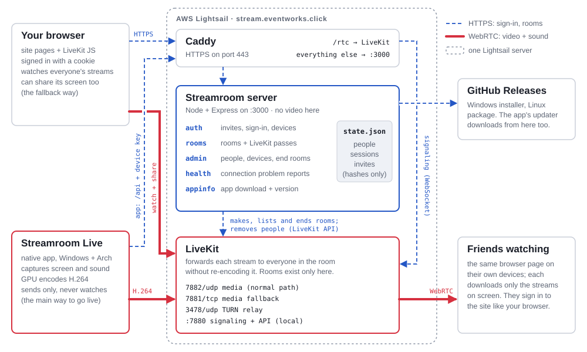

# How Streamroom works

There are two separate kinds of traffic. The **Streamroom server** handles who you are, which
rooms exist and hands out passes. **LiveKit** carries the actual video and sound. Video never
touches the Streamroom server.

- **Blue dashed (HTTPS):** sign-in, rooms, passes. Everything goes through Caddy on port 443:
  `/rtc` to LiveKit, everything else to the site on `:3000`.
- **Red solid (WebRTC):** live video and sound, straight to LiveKit, which forwards each stream
  to everyone in the room without re-encoding it.

## Step by step

### Watching in a browser

What every friend's browser does, from invite link to leaving.

1. **Browser → Streamroom server.** Opens their invite link once.
   `POST /api/auth/redeem` returns a session cookie that lasts 90 days and renews while used.
2. **Browser → server → LiveKit.** The lobby lists rooms; the server asks LiveKit and caches the
   answer for 1.5 seconds. Starting a room makes it in LiveKit with the title and creator stored
   on it. `GET /api/rooms` · `POST /api/rooms`
3. **Browser → Streamroom server.** Opening `/r/<room>` asks for a pass into that room.
   `POST /api/rooms/:id/join` returns a LiveKit token, good for 8 hours: may watch, and may
   share a screen.
4. **Browser ⇄ LiveKit (WebRTC).** Connects with the token. Signaling goes through Caddy at
   `/rtc`; video comes over UDP 7882 (TCP 7881 or TURN if blocked). `autoSubscribe` is off: the
   page picks streams itself and never downloads your own (for example the one your app is
   sending).
5. **Browser → Streamroom server.** If connecting fails, the page explains it in plain words and
   reports it with `POST /api/health/report`. It shows up in the admin Health panel.
6. **Browser, LiveKit.** Closing the tab disconnects. A room ends when the creator or an admin
   ends it (`POST /api/rooms/:id/end`), or after 5 minutes with nobody in it.

### Going live with the app

The browser hands you over to Streamroom Live, which signs itself in once and then sends your
screen.

1. **Browser → Streamroom server.** In a room: Go Live, then Open Streamroom Live.
   `POST /api/rooms/:id/app-open` returns a link
   `streamroom://open?server=…&room=…&pair=…`. The pair code works once, for 10 minutes.
2. **Your computer.** The link starts the app, or passes the link to the copy already running.
3. **App → Streamroom server.** Trades the pair code for its own device key with
   `POST /api/app/pair`. An app already signed in as you keeps its key. The key lasts 90 days,
   is saved as `account.dat`, can't open admin pages, and can be signed out from the Admin page.
4. **App → Streamroom server.** Asks for a pass into the room with
   `POST /api/rooms/:id/app-token`, sending the key as `Authorization: Bearer`. It gets a
   LiveKit token, 8 hours, that may only send screen and screen sound. It can't watch.
5. **App → LiveKit (WebRTC, LiveKit Rust SDK).** Connects the same way the browser does, then
   sends frames the GPU already encoded (see below).
6. **LiveKit → friends' browsers.** Every browser in the room sees a new screen share,
   subscribes, and shows it as a tile.

## Inside the app: screen to network

**Windows:** DXGI desktop duplication → D3D11 scale + NV12 on GPU → Media Foundation H.264
(NVENC / AMF / QuickSync) → LiveKit.
Sound: WASAPI loopback. Per-app sound needs Windows 10 build 20348 or Windows 11; older systems
fall back to all PC audio.

**Arch Linux:** screen picker (portal) or X11 → PipeWire → frame-rate gate → H.264 (VA-API,
NVENC, x264…) → LiveKit.
Built with GStreamer. Sound comes from PipeWire, per app or all PC audio. It can also save a copy
of the stream to `~/Videos/Streamroom` without encoding twice.

More detail is in [`app/CLAUDE.md`](../app/CLAUDE.md).

## Passes and ports

| Pass | Who holds it | Lasts |
|---|---|---|
| Invite link | a friend, once | 7 days |
| Session cookie | browser | 90 days, renews |
| Device link (QR) | another device, once | 10 min |
| Pair code | browser → app, once | 10 min |
| App device key | the app (no admin) | 90 days |
| LiveKit token | browser or app, per join | 8 hours |

| Port | What uses it |
|---|---|
| `443/tcp` | Caddy: site, `/api`, LiveKit signaling |
| `7882/udp` | LiveKit media, normal path |
| `7881/tcp` | LiveKit media when UDP is blocked |
| `3478/udp` | LiveKit TURN relay |
| `3000`, `7880` | local only, behind Caddy |

Nothing about rooms is saved by the Streamroom server; they live in LiveKit, so restarting the
server loses nothing. LiveKit only makes rooms when the server asks, so an ended room stays
ended.
